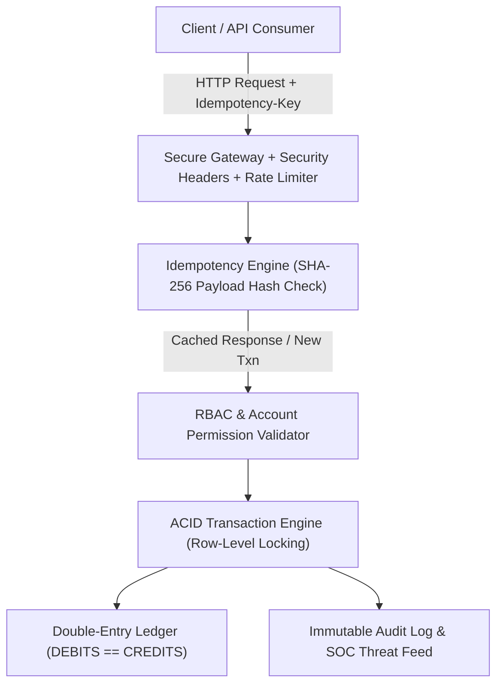

# 🛡️ BalanceVault — Secure Enterprise Financial Ledger Platform

> **Production-ready, mathematically verifiable multi-account financial ledger platform featuring double-entry accounting integrity ($\sum \text{Debits} = \sum \text{Credits}$), idempotency protection, row-level concurrency locking, OWASP Top 10 cybersecurity controls, RBAC governance, and a dedicated Security Operations Center (SOC) monitoring dashboard.**

[](https://opensource.org/licenses/MIT)
[](https://balance-vault-lac.vercel.app)
[](https://owasp.org/)
[](https://github.com/nithinpakki32-hue/balance-vault)
[-brightgreen.svg)](https://github.com/nithinpakki32-hue/balance-vault)
[](https://www.typescriptlang.org/)
[](https://nodejs.org/)
[](https://www.postgresql.org/)
[](https://www.prisma.io/)
[](https://redis.io/)

---

## 🌐 Live Production Deployment

The application is deployed and running on the Vercel Global Edge Network with full edge security headers and SPA routing:

| Environment | Endpoint | Status | Description |
|:---|:---|:---|:---|
| 🚀 **Production Web App (Primary)** | **[https://balance-vault-lac.vercel.app](https://balance-vault-lac.vercel.app)** | -brightgreen) | Primary Production App |
| 🔗 **Team Alias Domain** | **[https://balance-vault-nithinpakki32-hue.vercel.app](https://balance-vault-nithinpakki32-hue.vercel.app)** |  | Production Mirror Alias |
| 📦 **Vercel Deployment** | [View on Vercel](https://vercel.com/nithinpakki32-hue/balance-vault/J3WYsayBv5KVZyFsaLuaTBf6DbLE) |  | Deployment `dpl_J3WYsayBv5KVZyFsaLuaTBf6DbLE` |

---

## 🔐 Demo Testing Credentials

You can test the three distinct personas and permission tiers directly on the live deployment:

| Persona / Role | Email | Password | Pre-Provisioned Accounts & Assets | Permissions & Capabilities |
|:---|:---|:---|:---|:---|
| 👑 **Administrator** | `admin@balancevault.com` | `Admin@123` | **Master Treasury (`BV-TREASURY-001`):**<br>• Balance: **$1,000,000.00** | • Full System Authority<br>• Real-Time SOC Security Monitoring<br>• Grant / Revoke Account-Level Privileges<br>• View All Accounts, Transactions & Audit Trails |
| 👤 **Account Holder** | `user@balancevault.com` | `User@123` | **Checking (`BV-CHK-100293`):** $15,420.50<br>**Savings (`BV-SAV-883012`):** $45,000.00 | • Account Management & Liquidity Transfers<br>• Deposits & Withdrawals with Overdraft Shield<br>• Automatic Idempotency Key Replay Protection<br>• View Personal Accounts & Activity |
| 🛡️ **Auditor** | `auditor@balancevault.com` | `Auditor@123` | Read-only compliance observer | • Full Read-Only Ledger Verification<br>• Immutable Audit Trail Inspection<br>• SOC Threat Telemetry Access<br>• **Financial Mutations Strictly Blocked (HTTP 403)** |

> **Security Note:** All passwords use high-iteration PBKDF2 / bcrypt cryptographic hashing with per-user salt. 5 consecutive failed login attempts automatically trigger a 15-minute brute-force lockout (**HTTP 423 Locked**).

---

## 📑 Table of Contents

- [Live Production Deployment](#-live-production-deployment)
- [Demo Testing Credentials](#-demo-testing-credentials)
- [Overview](#-overview)
- [Financial Ledger Mechanics & Invariants](#-financial-ledger-mechanics--invariants)
- [Complete Cybersecurity Architecture](#-complete-cybersecurity-architecture)
- [Role-Based Access Control (RBAC) & Account Permissions](#-role-based-access-control-rbac--account-permissions)
- [First Administrator Bootstrap Flow](#-first-administrator-bootstrap-flow)
- [Security Operations Center (SOC) Dashboard](#-security-operations-center-soc-dashboard)
- [Automated Integration & Audit Test Suites](#-automated-integration--audit-test-suites)
- [API Endpoints Reference](#-api-endpoints-reference)
- [Environment Configuration](#-environment-configuration)
- [Quick Start Guide](#-quick-start-guide)
- [Database Migration & SQLSTATE 42501 Safety](#-database-migration--sqlstate-42501-safety)
- [License](#-license)

---

## 🌟 Overview

**BalanceVault** is engineered for financial institutions, fintech platforms, and audit environments requiring mathematically verifiable, zero-loss balance operations. It eliminates race conditions, double-spend vulnerabilities, unauthorized access, and credential brute-forcing through defense-in-depth architecture across all application tiers.

---

## 🏛 Financial Ledger Mechanics & Invariants



### 1. Mathematical Double-Entry Invariant
Every financial event creates balanced, paired debit and credit records:
$$\sum \text{Total Debits} = \sum \text{Total Credits}$$
- **Deposits:** Credit destination account, Debit system settlement clearing.
- **Withdrawals:** Debit source account, Credit system settlement clearing.
- **Transfers:** Debit source account, Credit destination account.

### 2. Idempotency Protection
- All mutating financial endpoints accept the `Idempotency-Key` HTTP header.
- Replaying the identical key and payload returns the cached result without duplicate mutations.
- Replaying the same key with an altered payload immediately fails with **HTTP 422 Unprocessable Entity**.

### 3. Concurrency & Overdraft Shield
- Row-level atomic updates (`balance: { gte: transferAmount }`) prevent balance race conditions.
- Strict rejection of negative amounts, zero amounts, and self-transfers (source account == destination account).

---

## 🛡️ Complete Cybersecurity Architecture

### 1. Authentication & Brute-Force Defense
- **PBKDF2-HMAC-SHA256 / bcrypt:** Cryptographic password hashing with high iteration counts and cryptographic salt.
- **Constant-Time Verification:** Dummy verification executed on non-existent accounts to eliminate timing side-channel attacks and user enumeration.
- **Brute-Force Account Lockout:** 5 consecutive failed login attempts automatically lock the account for 15 minutes (**HTTP 423 Locked**). Subsequent attempts are rejected immediately.
- **Multi-Factor Authentication (MFA):** TOTP/challenge token support for sensitive administrative actions.
- **Secure Password Reset:** Single-use, time-limited cryptographic tokens with automatic session invalidation.

### 2. HTTP Security Headers
- `Strict-Transport-Security`: `max-age=31536000; includeSubDomains; preload`
- `Content-Security-Policy (CSP)`: Disallows unauthorized third-party scripts, frames, and inline injections (`frame-ancestors 'none'; base-uri 'self'`).
- `X-Frame-Options`: `DENY` (clickjacking defense).
- `X-Content-Type-Options`: `nosniff` (MIME confusion defense).
- `Referrer-Policy`: `strict-origin-when-cross-origin`.
- `Permissions-Policy`: Restricts camera, microphone, geolocation, and payment hardware.
- `Cache-Control`: `no-store, no-cache, must-revalidate` on all sensitive financial and authentication routes.

---

## 👥 Role-Based Access Control (RBAC) & Account Permissions

| Role | Financial Mutations | Account Permission Oversight | View Accounts & Transactions | View Audit Trail & SOC |
|---|---|---|---|---|
| `ADMIN` | Full Authority | Full Authority (Grant/Revoke) | Yes | Yes |
| `ACCOUNT_HOLDER` | Permitted Accounts Only | No | Own Accounts Only | No |
| `AUDITOR` | **Strictly Forbidden (HTTP 403)** | No | Yes (Read-Only) | Yes (Read-Only) |

### Fine-Grained Account Permissions
Administrators can grant or revoke specific account-level capabilities per user:
- `canView`: View balances and transaction records.
- `canDeposit`: Execute top-ups and deposits.
- `canWithdraw`: Execute balance withdrawals.
- `canTransfer`: Initiate fund transfers to external or internal accounts.

---

## 🔑 First Administrator Bootstrap Flow

To guarantee zero unauthorized privilege escalation:
1. `POST /api/auth/bootstrap-admin` initiates the system during first deployment.
2. Once initialized, the endpoint permanently locks: all subsequent calls are rejected with **HTTP 409 Conflict** and generate a high-severity SOC alert.
3. Standard user registration (`POST /api/auth/register`) strictly assigns the `ACCOUNT_HOLDER` role, ignoring any role tampering in the request body.

---

## 📊 Security Operations Center (SOC) Dashboard

Accessible via the Admin portal, the SOC provides real-time security telemetry:
- **Total Failed Login Attempts:** Monitored across all identifiers.
- **Locked Accounts:** Real-time tally of brute-force lockouts with 1-click administrative unlocking.
- **Unauthorized Access Interceptions:** Log of blocked privilege escalation attempts and Auditor mutation requests (**HTTP 403**).
- **API Rate-Limit Violations:** Throttled abusive IPs (**HTTP 429**).
- **Live Threat Telemetry Feed:** Real-time audit events streamed with severity classification (`LOW`, `MEDIUM`, `HIGH`, `CRITICAL`).

---

## 🧪 Automated Integration & Audit Test Suites

BalanceVault provides two distinct, fully automated verification suites:

### 1. Functional Security & Financial Invariant Test Suite
Validates baseline OWASP security headers, brute-force lockout, double-entry integrity, and account-level RBAC:

```bash
python tests/security_and_ledger_test.py -v
```

```text
Ran 11 tests in 69.644s
OK (100% Passed)
```

### 2. Independent 24-Point Production Readiness & Concurrency Audit Suite
Executes multi-threaded concurrency (20 simultaneous deposits, 20 concurrent withdrawals with overdraft shielding, 20 parallel transfers), mathematical ledger reconciliation ($\sum \text{Debits} == \sum \text{Credits}$), RFC 6238 TOTP replay attacks, and static TypeScript security contract checks:

```bash
python scripts/audit_and_reconciliation_suite.py
```

```text
================================================================================
FINAL AUDITOR REPORT SUMMARY
================================================================================
Total Test Cases Evaluated: 24
  VERIFIED    : 24 (100%)
  FAILED      : 0
  NOT TESTED  : 0
  BLOCKED     : 0
--------------------------------------------------------------------------------
FINANCIAL LEDGER DISCREPANCY REPORT: ZERO DISCREPANCIES DETECTED
  - Total Debits strictly equal Total Credits
  - No completed transaction is missing double-entry records
  - Zero orphaned or unbalanced entries
  - No negative account balances detected under multi-threaded concurrency
================================================================================
```

---

## 📡 API Endpoints Reference

### Health & Monitoring
| Method | Endpoint | Access | Description |
|---|---|---|---|
| `GET` | `/api/health` | Public | Liveness probe with security status |
| `GET` | `/api/ready` | Public | Readiness probe (database, redis, security shield) |

### Authentication & Bootstrap
| Method | Endpoint | Access | Description |
|---|---|---|---|
| `POST` | `/api/auth/bootstrap-admin` | Rate-limited | First-admin initialization (single-use, 409 on duplicate) |
| `POST` | `/api/auth/register` | Rate-limited | User onboarding (strictly assigns `ACCOUNT_HOLDER`) |
| `POST` | `/api/auth/login` | Rate-limited | PBKDF2/bcrypt auth with brute-force lockout & MFA |
| `POST` | `/api/auth/forgot-password`| Rate-limited | Dispatches cryptographic password reset token |
| `POST` | `/api/auth/reset-password` | Rate-limited | Updates password and unlocks locked account |

### Financial Transactions & Double-Entry Ledger
| Method | Endpoint | Access | Description |
|---|---|---|---|
| `POST` | `/api/transactions/deposit` | Authenticated | Deposit funds with double-entry ledger & idempotency |
| `POST` | `/api/transactions/withdraw`| Authenticated | Withdraw funds with overdraft shield & idempotency |
| `POST` | `/api/transactions/transfer`| Authenticated | Atomic transfer with row-level locks & idempotency |
| `GET` | `/api/transactions` | Authenticated | Transaction history |
| `GET` | `/api/ledger` | Authenticated | Double-entry ledger audit inspection |

### Administration, RBAC & SOC
| Method | Endpoint | Role | Description |
|---|---|---|---|
| `GET` | `/api/admin/users` | `ADMIN` | User directory and account counts |
| `PATCH` | `/api/admin/accounts/:id/permissions` | `ADMIN` | Modify account permissions (`canDeposit`, `canTransfer`, etc.) |
| `GET` | `/api/admin/audit-logs` | `ADMIN`, `AUDITOR` | Immutable audit trail |
| `GET` | `/api/admin/security-stats`| `ADMIN` | SOC telemetry, metrics, and security threat feed |

---

## ⚙️ Environment Configuration

Copy `.env.example` to `.env`:

```bash
cp .env.example .env
```

| Variable | Description | Default / Example |
|---|---|---|
| `PORT` | Backend server port | `5000` |
| `NODE_ENV` | Application environment (`development` / `production`) | `production` |
| `DATABASE_URL` | Supabase Supavisor Transaction Pooler (`:6543`) | `postgresql://<user>.<ref>:<pass>@aws-0-us-east-1.pooler.supabase.com:6543/postgres?pgbouncer=true` |
| `DIRECT_URL` | Supabase Direct Connection for Prisma Migrations (`:5432`) | `postgresql://<user>:<pass>@db.<ref>.supabase.co:5432/postgres` |
| `REDIS_URL` | Redis / Upstash connection URL | `rediss://...` |
| `JWT_SECRET` | Secret key for JWT signing | `(32+ char secret string)` |
| `ADMIN_BOOTSTRAP_SECRET` | Secret key for initial admin bootstrap | `(16+ char secret token)` |

---

## 🗄️ Supabase Cloud Database Architecture

BalanceVault connects to **Supabase PostgreSQL 17** with dual connection endpoints:

1. **Transaction Pooler (Supavisor - Port 6543):** Set as `DATABASE_URL` with `?pgbouncer=true`. Provides connection pooling for high-concurrency Node.js serverless and API executions.
2. **Direct TCP Connection (Port 5432):** Set as `DIRECT_URL`. Used exclusively by Prisma CLI (`npx prisma migrate` and `npx prisma db push`) for transactional DDL schema updates.
3. **Row Level Security (RLS) & Role Isolation:**
   - All 8 application tables (`User`, `Account`, `AccountPermission`, `Transaction`, `LedgerEntry`, `IdempotencyRecord`, `AuditLog`, `SecurityEvent`) have **Row Level Security (RLS) enabled** to block unauthorized external anonymous PostgREST scraping.
   - The application connects via a dedicated non-superuser role (`bv_app_user`) equipped with `BYPASSRLS` privileges for internal application data integrity.

---

## 🚀 Quick Start Guide

### 1. Run Hardened Local Server
```bash
python server.py
```
Server launches on `http://localhost:8000` with full cybersecurity headers, double-entry ledger, and SOC dashboard.

### 2. Run Automated Test Suite
```bash
python tests/security_and_ledger_test.py -v
```

---

## 🛡️ Database Migration & SQLSTATE 42501 Safety

When running migrations against cloud-managed serverless PostgreSQL (such as Neon or Supabase):
1. BalanceVault avoids raw superuser extensions (`uuid-ossp`, `pgcrypto`) and utilizes native application UUIDv4 generators.
2. Neon serverless idle cold starts are guarded with exponential retry wrappers (`executeWithRetry`) in `src/lib/prisma.ts` to prevent HTTP 503 gateway drops.

---

## 📄 License

This project is licensed under the [MIT License](LICENSE).
